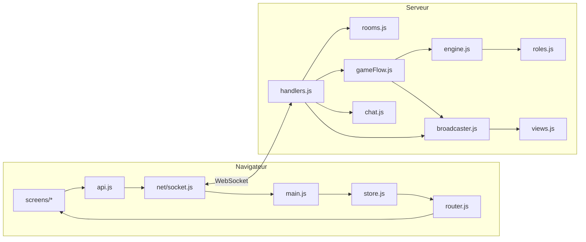

# Loup-Garou — المستذئبون

Jeu de Loup-Garou multijoueur en temps réel, interface en arabe : chaque joueur joue depuis son propre navigateur, le serveur décide de tout.

**Stack :** Node.js · Express · Socket.IO (WebSocket) · Vanilla JS en modules ES · Tailwind CSS.

## Lancer le jeu

```bash
npm install
npm start                 # http://localhost:3000
```

### Jouer en Wi-Fi (chaque joueur sur son téléphone ou son PC)

Le serveur écoute sur `0.0.0.0` : il accepte tous les appareils du réseau, pas seulement l'ordinateur qui le lance. Au démarrage, il affiche les adresses à partager :

```
🐺 Loup-Garou — اللعبة تعمل!
  Sur cet ordinateur : http://localhost:3000
  Pour les autres joueurs (même Wi-Fi) :
    http://192.168.1.24:3000
```

1. Tous les appareils doivent être sur **le même Wi-Fi**.
2. L'hôte crée la ville. Dans le salon, l'encadré 📶 affiche le lien Wi-Fi avec le code (ex. `http://192.168.1.24:3000/?code=K7PQ2M`) ; le bouton **Copier le lien** copie ce lien, même si l'hôte a ouvert le jeu sur `localhost`.
3. Les autres ouvrent ce lien : le code est déjà rempli, il suffit d'entrer son nom.

Si les autres n'arrivent pas à se connecter :
- **Windows** : au premier lancement, accepte la fenêtre du pare-feu pour Node.js en cochant « Réseaux privés ». Sinon, va dans Pare-feu Windows → Autoriser une application → Node.js.
- **macOS** : clique sur « Autoriser » quand macOS demande si Node peut accepter des connexions entrantes.
- Le Wi-Fi doit être en profil **privé** et non public, et certains réseaux d'école ou d'hôtel bloquent les appareils entre eux (« isolation client »). Dans ce cas, utilise le partage de connexion d'un téléphone.
- Pour écouter seulement sur cet ordinateur : `HOST=127.0.0.1 npm start`.

Pour tester seul avec moins d'onglets : `MIN_PLAYERS=3 npm start` (chaque **onglet** est un joueur différent).

| Variable | Défaut | Rôle |
| --- | --- | --- |
| `PORT` | 3000 | port HTTP |
| `HOST` | 0.0.0.0 | adresse d'écoute (0.0.0.0 = tout le réseau) |
| `MIN_PLAYERS` | 5 | joueurs minimum pour lancer |
| `MAX_PLAYERS` | 30 | joueurs maximum par ville |
| `TIME_SCALE` | 1 | multiplie tous les chronos (0.25 = 4× plus rapide, pour les tests) |

Le CSS compilé (`public/css/app.css`) est déjà dans le dépôt. Après avoir changé des classes Tailwind : `npm run build:css` (ou `npm run watch:css` pendant le développement).

## Règles par défaut (Loup-Garou)

Deux équipes : **les Loups-Garous** (المستذئبون) et **les Villageois** (القرويون). L'interface est en **arabe**, de droite à gauche.

**Joueurs :** 5 à 30 (maximum réglable avec `MAX_PLAYERS`). Rôles selon le nombre de joueurs (`server/roles.js` → `buildRoleDeck`) : 1 loup-garou pour 4 joueurs (au moins 1), un Détective, un Docteur, et le reste en Villageois.

| Joueurs | Loups-Garous | Villageois |
| --- | --- | --- |
| 5–7 | 1 | Détective, Docteur, Villageois |
| 8–11 | 2 | idem |
| 12–15 | 3 | idem |
| 20–23 | 5 | idem |
| 28–30 | 7 | idem |

| Rôle (nom affiché) | Équipe | Pouvoir de nuit |
| --- | --- | --- |
| 🐺 Loup-Garou (مستذئب) | Loups | choisit une victime avec les autres loups ; la victime est le joueur le plus choisi (égalité : le premier choisi). Les loups se reconnaissent et ont un chat privé la nuit. |
| 🔍 Détective (المحقق) | Village | découvre en secret si un joueur est loup-garou |
| 💉 Docteur (الطبيب) | Village | protège un joueur (lui-même possible), jamais le même deux nuits de suite |
| 🧑‍🌾 Villageois (قروي) | Village | aucun ; discute et vote |

**Déroulement :** salon → révélation des rôles (8 s) → nuit → aube (7 s) → débat → vote → verdict (7 s) → nuit… Les durées de nuit, débat et vote sont réglables par l'hôte.

- La nuit se termine quand tous les acteurs **connectés** ont choisi, sinon à la fin du chrono.
- Le vote est public. Le joueur avec strictement le plus de voix est éliminé ; **égalité ou aucun vote = personne**.
- Si un acteur ne joue pas, le chrono fait avancer la partie : un joueur absent ne bloque jamais la ville.
- **Victoire :** les Villageois gagnent quand il n'y a plus de loup-garou ; les Loups-Garous gagnent quand ils sont au moins aussi nombreux que les autres vivants.
- Les rôles des morts sont révélés (désactivable dans les réglages).

**Déconnexion :** rafraîchir la page ou perdre le réseau ne fait pas perdre sa place (identifiant de session secret, gardé par onglet). Dans le salon, une place est libérée après 30 s d'absence. « Quitter » pendant une partie compte comme une mort. Si l'hôte part, le badge passe au joueur connecté suivant.

## Architecture

```
server.js                 point d'entrée : Express + Socket.IO, branche les modules
shared/constants.js       contrat commun : noms d'événements, phases, canaux, limites
server/
  config.js               réglages et limites
  roles.js                catalogue des rôles, distribution, mélange
  engine.js               règles pures (nuit, vote, victoire) — sans socket, testable
  rooms.js                stockage des villes et joueurs (seul propriétaire de l'état)
  chat.js                 canaux, droits lecture/écriture, validation, anti-spam
  views.js                ce que chaque joueur a le droit de voir
  gameFlow.js             enchaînement des phases, chronos, annonces
  broadcaster.js          seul module qui envoie aux sockets
  handlers.js             un handler par événement client, validation des entrées
public/
  index.html              coquille de la SPA
  css/app.css             Tailwind compilé (source : styles/input.css)
  js/main.js              démarrage : connexion, store, routeur
  js/net/socket.js        gestion de la connexion WebSocket (request/on)
  js/state/store.js       miroir local de l'état envoyé par le serveur
  js/state/session.js     identifiant de session de l'onglet
  js/api.js               toutes les actions envoyées au serveur
  js/router.js            choix de l'écran sans recharger la page
  js/ui/                  dom.js (création d'éléments sûre), components.js, chatPanel.js
  js/screens/             home.js, lobby.js, game.js, end.js
tests/
  engine.test.js          tests unitaires des règles (npm test)
  e2e/fullGame.mjs        partie complète avec 5 navigateurs
  e2e/protocol.mjs        données invalides et événements dans le désordre
  e2e/bigGame.mjs         partie à 22 joueurs (1 navigateur + 21 bots)
docs/EVENTS.md            contrat d'événements et règles du chat
```



**Source de vérité unique :** l'objet `room` créé par `rooms.js`. Le navigateur n'en a qu'une copie filtrée (`views.js`) et ne décide jamais d'un résultat.

## Contrats des modules

| Module | Responsabilité | Expose | Lit / modifie | Dépend de |
| --- | --- | --- | --- | --- |
| `rooms.js` | créer, rejoindre, reprendre une ville ; hôte | `RoomStore` (`create`, `join`, `resume`, `removePlayer`, `reassignHost`, `delete`), `GameError` | crée et possède les objets `room` (en mémoire) | `config` |
| `engine.js` | règles du jeu | `assignRoles`, `validateNightAction`, `recordNightAction`, `isNightComplete`, `resolveNight`, `validateVote`, `recordVote`, `isVoteComplete`, `resolveVotes`, `checkWinner`, `forfeit` | joueurs et données de manche d'une `room` | `roles` |
| `gameFlow.js` | ordre des phases et chronos | `startGame`, `submitNightAction`, `skipDiscussion`, `castVote`, `playerLeft`, `afterPresenceChange`, `restart` | `room.phase`, `room.timer`, journal | `engine`, `roles`, `chat`, broadcaster (injecté) |
| `chat.js` | droits et stockage des messages | `canRead`, `writeBlocker`, `addPlayerMessage`, `addSystemMessage`, `historyFor` | `room.chat` (100 messages max par canal) | `roles` |
| `views.js` | filtre de l'état par joueur | `roomView(room, player)` | lecture seule | `engine`, `roles`, `chat` |
| `broadcaster.js` | envoi aux sockets | `state`, `chat`, `announce`, `privateResult`, `syncHistory`, `notice` | lecture seule | `views`, `chat` |
| `handlers.js` | entrée réseau, validation, présence | `registerHandlers(io, store, flow, out)` | connexion des joueurs | tous les modules serveur |
| `public/js/api.js` | actions du joueur | `createRoom`, `joinRoom`, `resume`, `leave`, `setReady`, `updateSettings`, `startGame`, `restartGame`, `nightAction`, `skipDiscussion`, `vote`, `sendChat` | session de l'onglet | `net/socket`, `state/session` |
| `public/js/screens/*` | affichage d'un écran | `(root, ctx) → { update(state), destroy() }` | le DOM de l'écran | `ui/*`, `api` |

Le détail de chaque événement (émetteur, payload, validation, destinataires, cas d'erreur) est dans [`docs/EVENTS.md`](docs/EVENTS.md).

## Tests

```bash
npm test                  # 13 tests des règles, aucune installation nécessaire
npm run test:e2e          # tests navigateur : démarre ses propres serveurs, puis les arrête
npm run test:e2e -- fullGame   # une seule suite (fullGame, protocol ou bigGame)
```

Les tests navigateur ont besoin de Playwright, à installer une seule fois :

```bash
npm i -D playwright
npx playwright install chromium
```

| Suite | Ce qu'elle vérifie |
| --- | --- |
| `tests/engine.test.js` | règles : distribution des rôles, attaque des loups, protection du Docteur, enquête, vote et égalité, victoire, droits du chat, aucune fuite d'information |
| `tests/e2e/fullGame.mjs` | partie complète avec 5 navigateurs (dont un écran de téléphone) : nom en double refusé, HTML affiché comme texte, chat des loups privé, enquête privée, rechargement sans perte de rôle, mort muet, vote, victoire, retour au salon |
| `tests/e2e/protocol.mjs` | 22 requêtes invalides ou dans le mauvais ordre, toutes refusées proprement |
| `tests/e2e/bigGame.mjs` | partie à 22 joueurs (1 navigateur + 21 bots) jusqu'à la victoire |

### Dans VS Code

- **Terminal** (`` Ctrl+` ``) : tape `npm test` ou `npm run test:e2e`. Ces commandes marchent aussi sous Windows (PowerShell).
- **Tâches** : `Ctrl+Shift+P` → « Tasks: Run Test Task » → choisis la tâche (fichier `.vscode/tasks.json`).
- **Débogage** : onglet Exécuter et déboguer (`Ctrl+Shift+D`) → « Lancer le serveur (debug) » ou « Tests des règles (debug) », puis `F5`. Les points d'arrêt fonctionnent dans `server/*.js`.
- **Panneau Tests (fiole)** : installe l'extension « Node.js Test Runner » (connor4312.nodejs-testing) pour voir et lancer chaque test de `engine.test.js` un par un.

Variables d'environnement sous Windows PowerShell (pour lancer le serveur à la main) :

```powershell
$env:MIN_PLAYERS="3"; npm start
```

## Corrigé par rapport au starter

- Le jeu suit maintenant les règles du Loup-Garou (Loups-Garous, Détective, Docteur, Villageois). Les rôles propres à la Mafia du starter (Parrain, Espion, Garde du corps, kidnapping) ont été retirés.
- Une déconnexion ou un joueur inactif bloquait la partie pour toujours. Maintenant il y a des chronos, et les absents ne sont pas attendus.
- Rafraîchir la page faisait perdre sa place. Maintenant la session est reprise, et l'hôte garde son rôle d'hôte.
- Les membres de l'équipe secrète ne se connaissaient pas ; il n'y avait ni écran de jeu, ni vote, ni chat.
