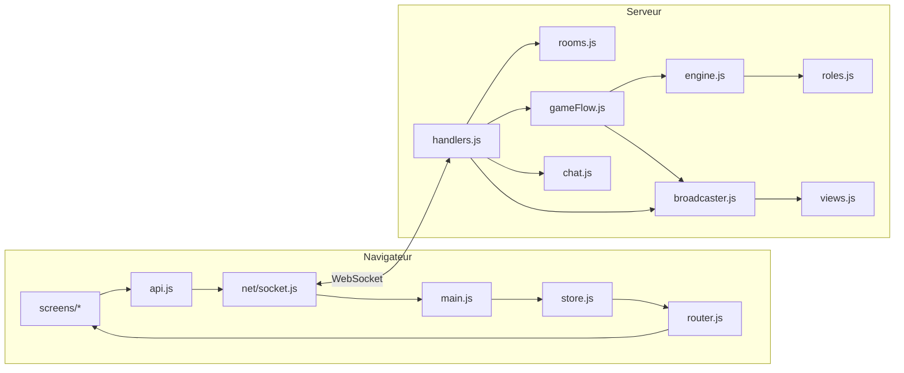

# Mafia: Shadow Conflict

Jeu de Mafia (famille Loup-Garou) multijoueur en temps réel : chaque joueur joue depuis son propre navigateur, le serveur décide de tout.

**Stack :** Node.js · Express · Socket.IO (WebSocket) · Vanilla JS en modules ES · Tailwind CSS.

## Lancer le jeu

```bash
npm install
npm start                 # http://localhost:3000
```

Pour jouer à plusieurs sur le même réseau, les autres ouvrent `http://<IP-de-ta-machine>:3000`.

Pour tester seul avec moins d'onglets : `MIN_PLAYERS=3 npm start` (chaque **onglet** est un joueur différent).

| Variable | Défaut | Rôle |
| --- | --- | --- |
| `PORT` | 3000 | port HTTP |
| `MIN_PLAYERS` | 5 | joueurs minimum pour lancer |
| `MAX_PLAYERS` | 30 | joueurs maximum par ville |
| `TIME_SCALE` | 1 | multiplie tous les chronos (0.25 = 4× plus rapide, pour les tests) |

Le CSS compilé (`public/css/app.css`) est déjà dans le dépôt. Après avoir changé des classes Tailwind : `npm run build:css` (ou `npm run watch:css` pendant le développement).

## Règles par défaut

**Joueurs :** 5 à 30 (maximum réglable avec `MAX_PLAYERS`). Rôles selon le nombre de joueurs (`server/roles.js` → `buildRoleDeck`) :

| Joueurs | Mafia | Ville |
| --- | --- | --- |
| 5–7 | Parrain | Détective, Médecin (+ Espion à 7), Citoyens |
| 8–11 | Parrain, Mafieux | Détective, Médecin, Espion, Garde du corps, Citoyens |
| 12–15 | Parrain, 2 Mafieux | idem |
| 16–19 | Parrain, 3 Mafieux | idem |
| 20–23 | Parrain, 4 Mafieux | idem |
| 24–30 | Parrain, 5 à 6 Mafieux | idem |

Règle générale : 1 membre de la Mafia pour 4 joueurs.

À 10 joueurs, on retrouve exactement la distribution du starter.

| Rôle | Pouvoir de nuit |
| --- | --- |
| 🎩 Parrain | choisit la victime (son choix est final) et peut kidnapper un joueur : celui-ci ne peut ni parler ni voter le lendemain. Le Détective le voit innocent. |
| 🔫 Mafieux | propose une victime ; décide seul si le Parrain est mort |
| 🔍 Détective | apprend si un joueur est Mafieux (le Parrain paraît innocent) |
| 💉 Médecin | sauve un joueur (lui-même possible), jamais le même deux nuits de suite |
| 🕵️ Espion | apprend si un joueur est le Parrain |
| 🛡️ Garde du corps | protège un autre joueur ; si la Mafia l'attaque, le Garde meurt à sa place |
| 🏠 Citoyen | aucun |

**Déroulement :** salon → révélation des rôles (8 s) → nuit → aube (7 s) → débat → vote → verdict (7 s) → nuit… Les durées de nuit, débat et vote sont réglables par l'hôte.

- La nuit se termine quand tous les acteurs **connectés** ont choisi, sinon à la fin du chrono.
- Le vote est public. Le joueur avec strictement le plus de voix est éliminé ; **égalité ou aucun vote = personne**.
- Si un acteur ne joue pas, le chrono fait avancer la partie : un joueur absent ne bloque jamais la ville.
- **Victoire :** la Ville gagne quand il n'y a plus de Mafia ; la Mafia gagne quand elle est au moins aussi nombreuse que les autres vivants.
- Les rôles des morts sont révélés (désactivable dans les réglages).

**Déconnexion :** rafraîchir la page ou perdre le réseau ne fait pas perdre sa place (identifiant de session secret, gardé par onglet). Dans le salon, une place est libérée après 30 s d'absence. « Quitter » pendant une partie compte comme une mort. Si l'hôte part, le badge passe au joueur connecté suivant.

## Architecture

```
server.js                 point d'entrée : Express + Socket.IO, branche les modules
shared/constants.js       contrat commun : noms d'événements, phases, canaux, limites
server/
  config.js               réglages et limites
  roles.js                catalogue des rôles, distribution, mélange
  engine.js               règles pures (nuit, vote, victoire) — sans socket, testable
  rooms.js                stockage des villes et joueurs (seul propriétaire de l'état)
  chat.js                 canaux, droits lecture/écriture, validation, anti-spam
  views.js                ce que chaque joueur a le droit de voir
  gameFlow.js             enchaînement des phases, chronos, annonces
  broadcaster.js          seul module qui envoie aux sockets
  handlers.js             un handler par événement client, validation des entrées
public/
  index.html              coquille de la SPA
  css/app.css             Tailwind compilé (source : styles/input.css)
  js/main.js              démarrage : connexion, store, routeur
  js/net/socket.js        gestion de la connexion WebSocket (request/on)
  js/state/store.js       miroir local de l'état envoyé par le serveur
  js/state/session.js     identifiant de session de l'onglet
  js/api.js               toutes les actions envoyées au serveur
  js/router.js            choix de l'écran sans recharger la page
  js/ui/                  dom.js (création d'éléments sûre), components.js, chatPanel.js
  js/screens/             home.js, lobby.js, game.js, end.js
tests/
  engine.test.js          tests unitaires des règles (npm test)
  e2e/fullGame.mjs        partie complète avec 5 navigateurs
  e2e/protocol.mjs        données invalides et événements dans le désordre
  e2e/bigGame.mjs         partie à 22 joueurs (1 navigateur + 21 bots)
docs/EVENTS.md            contrat d'événements et règles du chat
```



**Source de vérité unique :** l'objet `room` créé par `rooms.js`. Le navigateur n'en a qu'une copie filtrée (`views.js`) et ne décide jamais d'un résultat.

## Contrats des modules

| Module | Responsabilité | Expose | Lit / modifie | Dépend de |
| --- | --- | --- | --- | --- |
| `rooms.js` | créer, rejoindre, reprendre une ville ; hôte | `RoomStore` (`create`, `join`, `resume`, `removePlayer`, `reassignHost`, `delete`), `GameError` | crée et possède les objets `room` (en mémoire) | `config` |
| `engine.js` | règles du jeu | `assignRoles`, `validateNightAction`, `recordNightAction`, `isNightComplete`, `resolveNight`, `validateVote`, `recordVote`, `isVoteComplete`, `resolveVotes`, `checkWinner`, `forfeit` | joueurs et données de manche d'une `room` | `roles` |
| `gameFlow.js` | ordre des phases et chronos | `startGame`, `submitNightAction`, `skipDiscussion`, `castVote`, `playerLeft`, `afterPresenceChange`, `restart` | `room.phase`, `room.timer`, journal | `engine`, `roles`, `chat`, broadcaster (injecté) |
| `chat.js` | droits et stockage des messages | `canRead`, `writeBlocker`, `addPlayerMessage`, `addSystemMessage`, `historyFor` | `room.chat` (100 messages max par canal) | `roles` |
| `views.js` | filtre de l'état par joueur | `roomView(room, player)` | lecture seule | `engine`, `roles`, `chat` |
| `broadcaster.js` | envoi aux sockets | `state`, `chat`, `announce`, `privateResult`, `syncHistory`, `notice` | lecture seule | `views`, `chat` |
| `handlers.js` | entrée réseau, validation, présence | `registerHandlers(io, store, flow, out)` | connexion des joueurs | tous les modules serveur |
| `public/js/api.js` | actions du joueur | `createRoom`, `joinRoom`, `resume`, `leave`, `setReady`, `updateSettings`, `startGame`, `restartGame`, `nightAction`, `skipDiscussion`, `vote`, `sendChat` | session de l'onglet | `net/socket`, `state/session` |
| `public/js/screens/*` | affichage d'un écran | `(root, ctx) → { update(state), destroy() }` | le DOM de l'écran | `ui/*`, `api` |

Le détail de chaque événement (émetteur, payload, validation, destinataires, cas d'erreur) est dans [`docs/EVENTS.md`](docs/EVENTS.md).

## Tests

```bash
npm test                  # 13 tests unitaires des règles (aucune dépendance)
```

Tests de bout en bout (Playwright, à installer à part : `npm i -D playwright && npx playwright install chromium`) :

```bash
TIME_SCALE=0.25 PORT=3100 npm start
BASE_URL=http://localhost:3100 node tests/e2e/fullGame.mjs    # partie complète, 5 navigateurs
MIN_PLAYERS=3 PORT=3101 npm start
BASE_URL=http://localhost:3101 node tests/e2e/protocol.mjs    # 22 cas invalides ou hors ordre
```

`fullGame.mjs` vérifie : nom en double refusé, chat du salon (HTML affiché en texte), lancement bloqué tant que tout le monde n'est pas prêt, chat Mafia invisible pour les autres, résultat privé du Détective, mort de la nuit, rechargement de page sans perte de rôle, mort muet au village, vote, victoire de la Ville, retour au salon. Un joueur joue sur un écran de téléphone (390 px).

## Corrigé par rapport au starter

- Garde du corps : protéger la bonne cible tuait le Garde **et** la victime. Maintenant seul le Garde meurt.
- Une déconnexion ou un joueur inactif bloquait la partie pour toujours. Maintenant il y a des chronos, et les absents ne sont pas attendus.
- Rafraîchir la page faisait perdre sa place. Maintenant la session est reprise.
- Les Mafieux ne connaissaient pas leurs complices ; il n'y avait ni écran de jeu, ni vote, ni chat.
- Le message de fin de vote était perdu, le Médecin ne pouvait jamais se soigner, et le Parrain pouvait kidnapper un complice.
